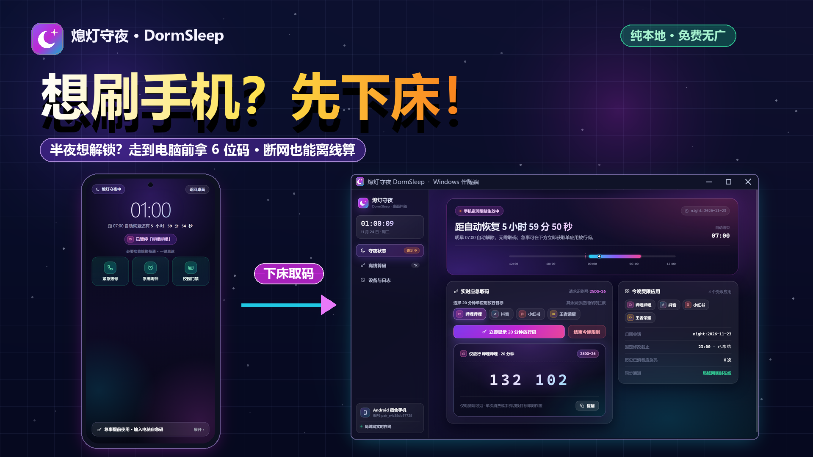
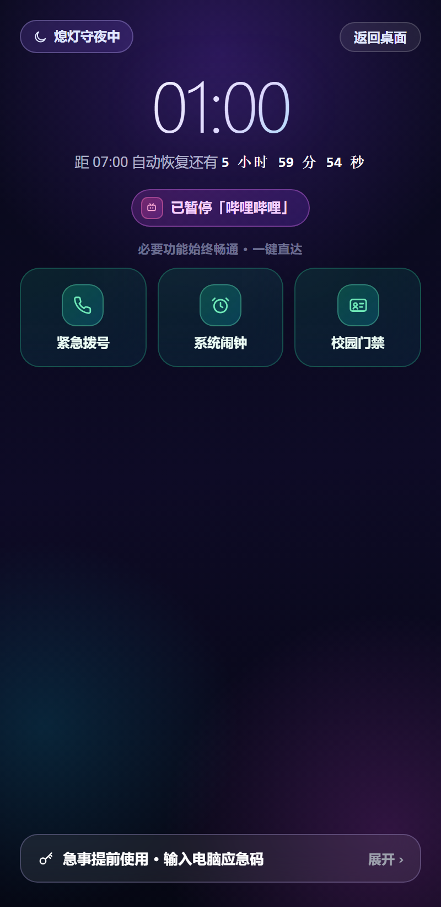
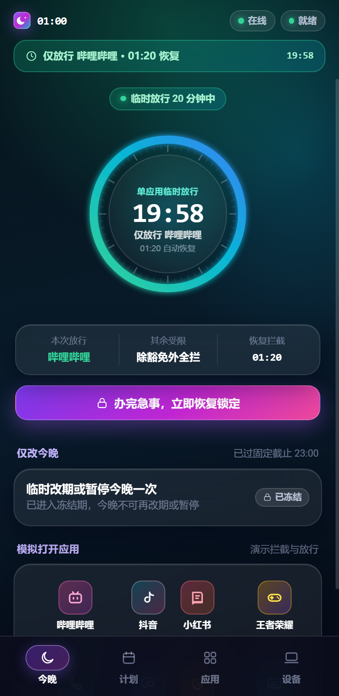
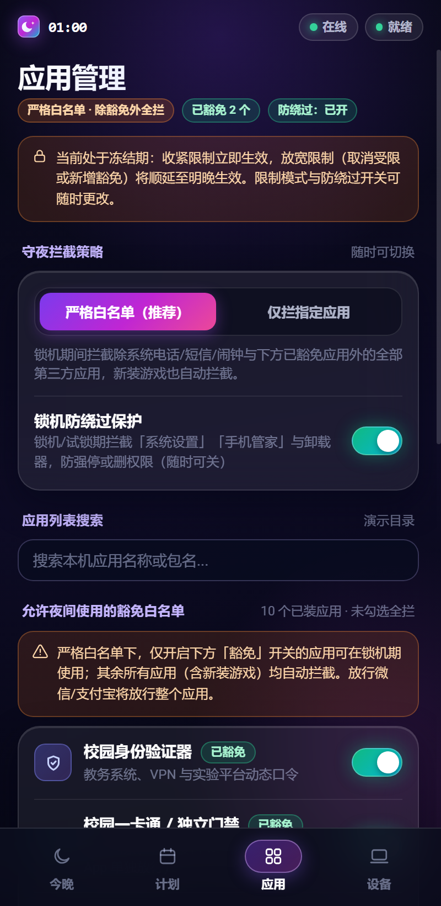
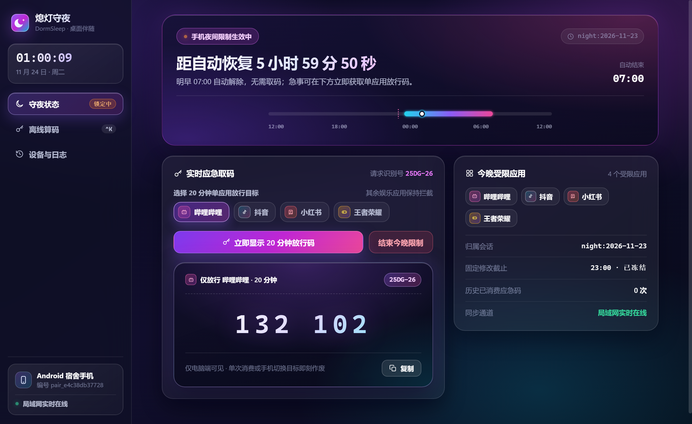
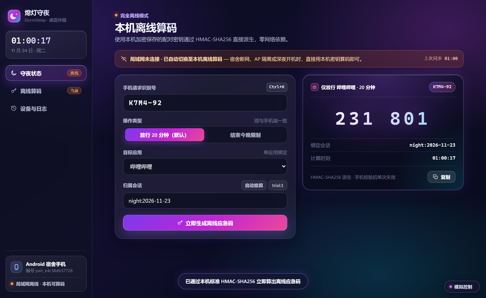

<div align="center">

# 🌙 熄灯守夜 · DormSleep

**「上床后想破戒？先下床，走到电脑前取码。」**

一款 **100% 纯本地、免注册、无云端、零广告** 的双端物理防熬夜工具（**Android + Windows**）

[](#快速开始)
[](#隐私与安全设计)
[](#下载与安装)

<br />



</div>

---

## 为什么做「熄灯守夜」？

市面上大多数自律软件都在**同一台手机上**设门槛——躺被窝里 3 秒就能破功；而太激进的锁机软件又会让人担心半夜真有急事、误拦早八闹钟或隐私上传云端。

**熄灯守夜（DormSleep）** 的核心思路很简单：
1. **物理下床门槛**：把解锁的动作放到离床几米远的宿舍电脑上，靠物理摩擦拦截 95% 的无意识熬夜刷手机；
2. **急事不罚站**：真有急事（赶 DDL、回重要消息、查资料）时走到电脑前点击即出 6 位一次性码，**默认仅放行该单个应用 20 分钟**，其余娱乐软件保持拦截，到点自动拉回；
3. **绝对纯本地**：不注册账号、不经过任何第三方云端服务器、零广告弹窗；就算宿舍半夜断网，也能用本机密钥通过 **HMAC-SHA256** 离线算码。

---

## 核心特性

- **双模式守夜策略（随时可切换）**
  - **严格白名单（默认推荐）**：锁机期间拦截除「系统电话/短信/闹钟/桌面/输入法」与你勾选的「豁免应用」之外的全部第三方应用（新装游戏也会自动拦截）。
  - **仅拦指定应用**：支持实时扫描本机真实已装应用与搜索，按需勾选黑名单。
- **四重防绕过机制**
  - **命中即踢回桌面**：弹出深空低亮全屏拦截页的同时，主动将受限应用压入后台并接管返回键；
  - **150ms 多信号前台检测 + 可选无障碍 0ms 增强**：同时监控 `UsageEvents` 生命周期、触摸交互与 Android 10+ `lastTimeVisible`，开启可选无障碍服务后可 0ms 封堵后台多任务切卡、悬浮小窗与分屏（仅读取窗口包名，绝不读取任何屏幕文字或密码）；
  - **锁机防绕过保护（默认开启、随时可关）**：锁机/试锁期同步拦截「系统设置」「手机管家」与卸载器，并配有 `onTaskRemoved` 1 秒看门狗自动拉活；
  - **固定修改截止时间**：就寝计划修改截止时间固定（开始前 30 分钟），推迟开始不延长修改窗口；冻结期内放宽限制顺延至明晚生效。
- **断网 / 热点 / 关机全场景可用**
  - 手机端独立计时与锁定，电脑关机不影响准点锁机与次日准点自然恢复；
  - 宿舍断网、AP 隔离时自动切入 **本机离线算码（`Ctrl+K`）**，输入手机 6 位识别号即刻离线派生一次性应急码；
  - 电脑连手机热点搜不到局域网广播时，支持手动填写电脑局域网地址直连配对。
- **诚实边界与关键服务保护**
  - 紧急拨号、短信、早八闹钟属于强制保护项，永远畅通；
  - 微信/支付宝等含校园码小程序的应用，豁免时会明确提示「Android 普通权限将放行整个应用」。

---

## 界面预览

| 手机端 · 深空全屏拦截页 | 手机端 · 20 分钟单应用放行 | 手机端 · 白名单与防绕过 |
| :---: | :---: | :---: |
|  |  |  |

| Windows 电脑端 · 0 等待实时出码 | Windows 电脑端 · 断网离线 HMAC-SHA256 算码 |
| :---: | :---: |
|  |  |

---

## 下载与安装

前往本仓库的 **[Releases](../../releases)** 页面下载 `v1.0.0`：

- **Android 手机端**：`DormSleep-v1.0.0-android.apk`（Android 8.0+ / HarmonyOS）
- **Windows 电脑端**：`DormSleep-v1.0.0-windows.exe`（Windows 10/11 64 位，免安装单文件）
- **校验文件**：`SHA256SUMS.txt`

> **Windows SmartScreen 提示说明**：个人免费开源项目未购买商业 EV 代码签名证书，首次运行 `.exe` 如弹出蓝色安全提示，点击「更多信息」→「仍要运行」即可；也可以自行从源码直接运行 Python 伴随服务。

---

## 快速开始

1. **启动电脑端**：双击 `DormSleep-v1.0.0-windows.exe`，点击「生成 8 位配对码」。
2. **手机授权与配对**：安装 APK，开启「使用情况访问 + 悬浮窗显示 + 精确闹钟 + 忽略电池优化」，输入 8 位配对码完成纯本地局域网配对。
   - *热点直连提示*：若电脑连接手机热点导致自动发现失败，关闭电脑代理/梯子，并将电脑页显示的「本机局域网地址（如 `192.168.43.128:4180`）」填入手机配对框即可秒连。
3. **可选开启无障碍增强**：在手机端「应用」页打开「防后台切换增强（无障碍）」，彻底封堵多任务后台切卡、悬浮小窗与分屏。

### 各品牌安卓手机后台保活建议

| 品牌 / 系统 | 建议配置 |
| --- | --- |
| **荣耀 / 华为（MagicOS / HarmonyOS）** | 设置 → 应用 → 应用启动管理 → 关闭自动管理，开启「允许自启动 + 允许后台活动」，多任务页下拉锁定卡片 |
| **小米 / 红米（澎湃 OS / MIUI）** | 应用管理 → 熄灯守夜 → 省电策略「无限制」，开启「自启动」与「后台弹出界面」 |
| **OPPO / 一加 / 真我（ColorOS）** | 应用管理 → 耗电管理 → 开启「允许完全后台行为」与「允许自启动」 |
| **vivo / iQOO（OriginOS）** | i管家 → 权限管理 → 开启「自启动」「后台弹出界面」「悬浮窗」，电池选「高耗电允许」 |

---

## 隐私与安全设计

- **零云端通信**：除用户自己的手机与电脑在局域网内的直接通信外，应用不向任何外部服务器发送网络请求。
- **密钥本地加密存储**：
  - Android 端使用 **Android Keystore (AES-256-GCM)** 加密保存配对密钥；
  - Windows 端使用 **Windows DPAPI** 用户级加密存储，Web 控制面板前端无法读取明文密钥。
- **一次性强绑定与防重放**：每个 6 位应急码严格绑定 `pairId + sessionId + requestId + actionType + targetAppId`，单次消费或切换目标应用立即作废，重启后已消费记录仍持久防重放。

---

## 从源码构建与测试

```bash
# 1. 启动浏览器双端模拟演示服务（无需真机即可体验全流程）
python3 mock-bridge/server.py

# 2. 运行全套自动化验收测试（9 组核心流程 + 7 组 Windows 伴随服务真实集成测试）
python3 tests/verify_flows.py
python3 tests/verify_windows_companion.py

# 3. 同步前端静态资源至 Android WebView 工程
python3 apps/android-native/sync_web_assets.py

# 4. 启动 Windows 真实伴随服务（源码运行）
python services/windows-companion/tray_app.py
```

---

## 仓库目录结构

```text
dormsleep/
├── apps/
│   ├── android-native/        # Android 原生 Kotlin 工程（状态机、监控服务、无障碍增强、局域网同步）
│   ├── mobile/                # 手机端现代渐变风 WebView UI
│   ├── desktop/               # Windows 电脑端 Web UI
│   └── launcher/              # 双端联调演示入口
├── services/
│   └── windows-companion/     # Windows 真实后台伴随服务（托盘、SQLite、DPAPI、UDP发现、PyInstaller打包）
├── shared/                    # 双端共享常量、时钟表盘、排程引擎与加密规范
├── adapters/                  # 真实端与模拟演示环境统一适配层
├── mock-bridge/               # 浏览器双端联调与自动化测试模拟服务
└── tests/                     # 16 组端到端自动化验收与集成测试
```

---

<div align="center">
  <sub>熄灯守夜 · DormSleep — 把意志力留给更重要的事，祝你今晚睡个好觉。</sub>
</div>
